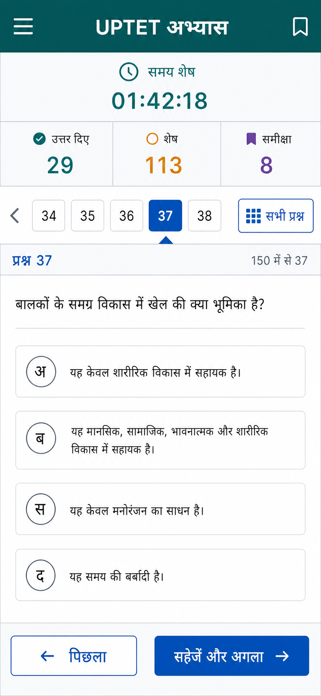

# UPTET Mobile Exam Design

## Goal

Convert `paper1.pdf` and `paper2.pdf` into two trustworthy, mobile-first HTML exam papers containing all 150 questions, four options per question, answer keys, and explanations from their respective PDFs.

Each generated exam must work as a standalone HTML file. The same files will also be published through a small GitHub Pages site.

## Approved Visual Direction

The selected direction is **Fast Navigator**:

- serious national-testing-portal appearance
- mobile-first layout with high-contrast Hindi text
- teal header, blue active-question state, amber unanswered state, and violet review state
- prominent remaining time and compact status counts
- nearby question-number strip plus a full 150-question palette
- large tap targets and a sticky bottom navigation area
- restrained borders and shadows; no decorative clutter

Reference concept:

The reference is directional, not pixel-perfect. The implementation must correct mockup weaknesses: use accessible labels, avoid invented official logos, fit smaller phones, and keep all controls usable with long Hindi questions.

## Deliverables

- `index.html`: a simple paper selector that does not start either exam timer.
- `paper1.html`: self-contained Paper 1 exam.
- `paper2.html`: self-contained Paper 2 exam.
- Source data and generation scripts used to produce and validate the final HTML files.
- GitHub Pages deployment containing the three HTML pages.

Opening `paper1.html` or `paper2.html` starts or resumes that paper immediately.

## Exam Rules

- Duration: 2 hours 30 minutes.
- Questions: 150.
- Marks: 150, one mark per correct answer.
- Negative marking: none.
- Every question has exactly four selectable options.
- Answers and explanations remain hidden while the attempt is active.
- Manual submission remains disabled until all 150 questions have an answer.
- When time expires, the exam submits automatically even if questions remain unanswered.
- Reopening the page resumes the original countdown; it never grants a fresh 2 hours 30 minutes.
- Selected answers, review marks, current question, and start time persist in the same browser.
- A user cannot change answers after submission.

## Attempt and Review Model

Each paper stores:

1. one active attempt, if an exam is in progress
2. one latest completed attempt

The latest completed attempt contains:

- submission date and time
- whether submission was manual or caused by timeout
- score and answered count
- time used
- the user's selected answer for each question
- the correct answer for each question
- the PDF explanation for each question

The **Review Latest Attempt** action opens only the latest completed attempt. Completing another attempt replaces that record; no older history is retained.

The **Start New Attempt** action:

- requires explicit confirmation
- clears only the active attempt
- preserves the latest completed attempt for review
- starts a new 2 hour 30 minute timer

## Screen Structure

### Paper Selector

The index page shows Paper 1 and Paper 2 as separate choices, with duration, question count, and a warning that opening a paper starts its timer.

### Active Exam

The active exam uses:

- sticky header with paper name and remaining time
- status summary for answered, remaining, and marked-for-review counts
- section name
- short nearby-question navigator
- full question palette in a modal or bottom sheet
- one question at a time
- four full-width option rows
- Previous, Mark for Review, and Save & Next controls
- Submit button visible but disabled until all 150 are answered

Question states must use both color and a non-color indicator:

- current
- answered
- unanswered
- marked for review
- answered and marked for review

### Submission Result

After manual or automatic submission, show:

- total score
- correct, incorrect, and unanswered counts
- percentage
- time used
- Review Answers
- Start New Attempt

### Review

The review screen lists all questions and clearly shows:

- the user's answer
- the correct answer
- correct/incorrect/unanswered status
- explanation

The review mode has no editable controls and does not expose answers from an active attempt.

## Responsive and Accessibility Requirements

- Primary target: phones from 360 pixels wide.
- Desktop layout may add whitespace or a side palette but must preserve the same behavior.
- All option rows and primary buttons have at least a 44-pixel touch target.
- Hindi text uses installed system fonts and does not depend on a network font.
- Body text remains at least 16 pixels on phones.
- Keyboard navigation, visible focus states, semantic radio controls, and descriptive button labels are required.
- The timer uses an ARIA live region without announcing every second.
- Status meaning never relies only on color.
- Motion is minimal and respects reduced-motion preferences.

## Data Extraction and Fidelity

The PDFs use embedded Devanagari fonts whose ordinary text extraction is corrupted. Extraction must therefore use rendered-page OCR or another glyph-faithful method, followed by structural validation and visual spot checks against the rendered PDF.

For each paper, validation must confirm:

- question numbers 1 through 150 exist exactly once
- every question has exactly four options
- every question has one answer key
- every question has one explanation
- section boundaries and question ranges match the PDF
- Hindi punctuation, numerals, mathematical notation, and English parentheticals remain readable

No question or explanation may be silently invented. If OCR produces an ambiguous character, it must be resolved against the rendered source page.

## Technical Architecture

Source data is stored separately during development as structured JSON. A deterministic generator injects the paper-specific data and shared exam engine into each final HTML file.

The final `paper1.html` and `paper2.html` contain:

- inline CSS
- inline JavaScript
- embedded paper data
- no external runtime dependency
- no answer-key UI until submission

Browser state uses versioned `localStorage` keys unique to each paper. The timer is calculated from the stored `startedAt` timestamp, not from a decrementing counter, so closing the page cannot pause or reset it.

The answer key must exist in the standalone file for offline scoring. It can be encoded to prevent accidental discovery in ordinary page text, but it cannot be made secure against someone intentionally inspecting the HTML source or browser developer tools. The interface, not cryptography, enforces exam mode.

## Error Handling

- If stored state is malformed or from an incompatible version, preserve the latest completed attempt when possible and offer to reset the active attempt.
- If storage is unavailable, show a blocking warning that progress cannot survive closing the page.
- If a submitted attempt is reopened, show the result/review state rather than restarting it.
- Submission is idempotent: refreshes cannot create conflicting scores.
- Expired active attempts auto-submit during the next page load.

## Testing

Automated tests must verify:

- each paper contains 150 questions and 600 options
- question numbers are complete and unique
- every question has a valid answer and non-empty explanation
- timer duration is exactly 9,000 seconds
- reopening preserves the original start time
- timeout submits incomplete attempts
- manual submission is blocked before all questions are answered
- answers are hidden during an active attempt
- submission reveals score, correct answers, and explanations
- only the latest completed attempt is retained
- starting a new attempt preserves the latest completed review
- generated HTML has no required external asset or script

Browser checks must cover a phone viewport and a desktop viewport. Visual QA must inspect the selector, active exam, palette, result, review, and reset-confirmation states.

## Deployment

The project will be initialized as a Git repository, committed, and published to a GitHub repository under the authenticated user's account. GitHub Pages will serve from the repository's default branch root or a Pages workflow, depending on the repository settings available at deployment time.

Deployment is complete only after the public Pages URL loads `index.html`, both paper links open, and an exam can select and persist an answer after reload.

